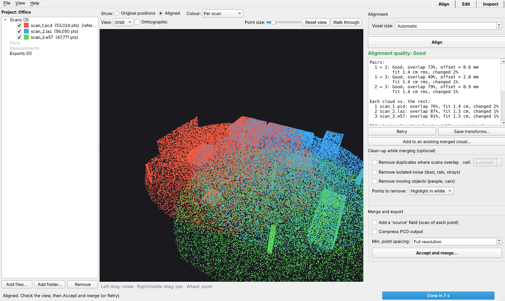

# PCD Merge

A desktop program for LiDAR point clouds: drag in two or more `.pcd` files, it
aligns them automatically, shows you the result in 3D, and on your OK merges
them into a single file (PCD, PLY, LAS/LAZ or E57).



## How it works

* **Only rigid transforms** (rotation + translation) are estimated, because all
  scans come from the same sensor and have the same scale.
* **Alignment runs on thinned copies.** Each cloud is voxel-downsampled, normals
  and FPFH features are computed, and a RANSAC search over feature matches finds
  the alignment without needing any starting guess. Each candidate is refined
  with point-to-plane ICP (coarse, then finer), and the best one is kept.
* **The ground is not used to match features.** The dominant plane (usually the
  ground) is set aside when matching and scoring, because flat ground looks the
  same everywhere and otherwise produces convincing but wrong alignments. It is
  still used by ICP to get height and tilt exactly right.
* **Three or more clouds:** every pair is registered, the most reliable pairs
  form a pose graph, and the graph is optimised so all clouds agree with each
  other. The first file is the reference frame.
* **Merging uses every original point.** The transforms are applied to the
  full-resolution files, and all per-point fields (intensity, ring, timestamp,
  normals, colour, ...) are kept. Normals are rotated along with the points.
  Points with NaN coordinates are dropped. The output is an unorganised binary
  PCD (optionally `binary_compressed`).

The app reports, for every pair, how much of the clouds overlap after
alignment, and warns when a cloud overlaps the others by less than 30% or could
not be matched at all. In that case press **Retry** (new random start) or try a
larger voxel size.

## Install on Windows (no Python needed)

1. Download the latest `PCD-Merge-…-windows-x64.zip` from
   [Releases](https://github.com/LeonSutliffe/PCD-Merge/releases/latest).
2. Unzip it anywhere and double-click **PCD Merge.exe** inside.
3. The first time, it offers to install itself for your user account. Say yes:
   it copies itself to `%LOCALAPPDATA%\PCD Merge`, puts a **PCD Merge**
   shortcut on your Desktop and in the Start menu, and starts. You can delete
   the unzipped folder afterwards.

From then on, start it from the shortcut. Each start checks for a newer
release; if there is one it asks, downloads it, swaps it in and starts the new
version. "Skip this version" stops it asking about that release. Offline, it
just starts.

Windows may show a SmartScreen warning the first time because the program is
not code-signed: choose *More info*, then *Run anyway*.

To check an installation works: `"PCD Merge.exe" --selftest` (writes
`%TEMP%\pcd-merge-selftest.log`).

## Install from source

Python 3.10 or newer.

```bash
git clone https://github.com/LeonSutliffe/PCD-Merge.git
cd PCD-Merge
python -m venv .venv
# Windows: .venv\Scripts\activate    macOS/Linux: source .venv/bin/activate
pip install -e ".[fast]"
```

`[fast]` adds `python-lzf` for quick `binary_compressed` files. If it fails to
install on your machine, use `pip install -e .`; compressed files are then
still readable, just more slowly.

On Linux, Open3D needs `libegl1 libgl1 libgomp1` from your package manager.

## Use

### Desktop app

```bash
pcd-merge            # or: python -m pcd_merge
```

1. Drag `.pcd` files (or a folder of them) onto the window.
   *Original positions* shows the scans as they are in the files.
2. Press **Align**. The view switches to *Aligned*, each cloud in its own colour.
3. Check the result. Untick a file in the list to hide it.
4. **Accept and merge...** writes the merged file, or **Retry** to try again.
   Pick the format in the save dialog (see *Output formats* below).
   **Save transforms...** writes the 4x4 matrices as JSON.

To make the output smaller, set **Min. point spacing** (in the scans' units,
e.g. `0.02` for 2 cm). The merged cloud is then thinned so no two points are
closer than that. Original points are kept, not averaged, so intensity and the
other fields stay exactly as measured. The default, *Full resolution*, saves
every point.

### Output formats

| Format | Opens in | What is kept |
| --- | --- | --- |
| `.pcd` | PCL, CloudCompare, ROS | every field |
| `.ply` | CloudCompare, MeshLab, Blender | every field (`rgb` becomes red/green/blue, normals become nx/ny/nz) |
| `.las` / `.laz` | survey and GIS software, CloudCompare | intensity, colour, GPS time (from `timestamp`/`time`/`t`), `source` as point source ID; every other field as a LAS extra field |
| `.e57` | Recap, Cyclone, Scene, CloudCompare | coordinates (double precision), intensity, colour, time stamp; other fields are left out |

LAS stores intensity as whole numbers 0-65535. Integer intensities are stored
as they are; fractional ones (e.g. 0-1 floats) are rescaled to the full 16-bit
range and the exact values are also kept in an `intensity_raw` extra field.
LAS coordinates are stored at 0.1 mm resolution. The app tells you after saving
if anything could not be stored in the chosen format.

Voxel size is *Automatic* by default (about 40,000 points per thinned cloud).
Set it by hand, in the scans' units, if alignment fails: larger is more robust
and faster, smaller is more precise. It never affects which points are merged.

### Command line

```bash
pcd-merge scan1.pcd scan2.pcd scan3.pcd -o merged.pcd --transforms transforms.json
pcd-merge scan1.pcd scan2.pcd -o merged.laz --min-spacing 0.02
```

The output extension picks the format (`.pcd`, `.ply`, `.las`, `.laz`, `.e57`).
Options: `--voxel 0.3`, `--min-spacing 0.02` (thin the output), `--seed 1` (repeatable runs), `--source-field` (adds a
`source` field telling which file each point came from), `--compressed` (PCD only), and
`--force` (merge even if some cloud could not be aligned).

## Limits and next steps

* Needs real overlap between scans; below roughly 30% alignment gets unreliable.
* Very repetitive or symmetric places (long identical corridors, empty fields)
  can align to the wrong spot. The overlap numbers and the preview are there to
  catch this.
* Planned: GPU acceleration for very large scans (NVIDIA), and a first-person
  walk-through view for building-sized scans.
* Planned: a manual fallback where you pick a few matching points in two clouds
  to give the alignment a start.

## Large scans

Loading, aligning and merging run in the background. The progress bar shows
percent done, elapsed time and an estimate of the time left, and **Cancel**
stops the current step without losing anything already loaded.

Measured on three synthetic scans of about 24 million points each (71 million
in total, 4-core machine), from loading to a saved merged file:

| | Time | Peak memory |
|---|---|---|
| 0.3.0 | 55 to 60 s | 4.9 GB |
| 0.6.0 | 30 to 33 s | 3.8 GB |

To time your own machine: `python benchmarks/bench_large.py --points 20000000`.

GPU acceleration is not used: the Windows build of Open3D is CPU-only.

## Releasing a new version

1. Bump `__version__` in `pcd_merge/__init__.py` (e.g. `0.2.0` → `0.3.0`).
2. Merge to `main`. The *windows build* workflow builds and tests the bundled
   program and publishes release `v0.3.0` with the zip.
3. Installed copies offer the update the next time they start.

Every PR also gets a test build of the zip under the workflow run's artifacts.
To build locally on Windows: `pip install -e ".[build]"` then
`pyinstaller packaging/pcd_merge.spec` (output in `dist\PCD Merge`).

## Development

```bash
pip install -e ".[test]"
pytest
```

The tests build a synthetic outdoor scene, cut overlapping scans out of it with
known poses, and check that alignment recovers those poses and that merging
keeps every point and field.
