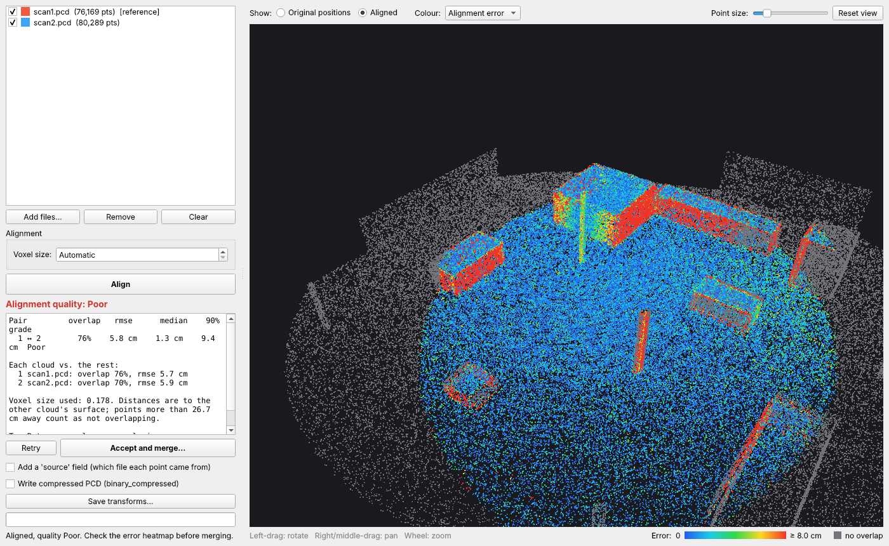

# PCD Merge

A desktop program for LiDAR point clouds: drag in two or more `.pcd` files, it
aligns them automatically, shows you the result in 3D, and on your OK merges
them into a single `.pcd` file.


## How it works

* **Only rigid transforms** (rotation + translation) are estimated, because all
  scans come from the same sensor and have the same scale.
* **Alignment runs on thinned copies.** Each cloud is voxel-downsampled, normals
  and FPFH features are computed, and a RANSAC search over feature matches finds
  the alignment without needing any starting guess. Each candidate is refined
  with point-to-plane ICP (coarse, then finer), and the best one is kept.
* **The ground is not used to match features.** The dominant plane (usually the
  ground) is set aside when matching and scoring, because flat ground looks the
  same everywhere and otherwise produces convincing but wrong alignments. It is
  still used by ICP to get height and tilt exactly right.
* **Three or more clouds:** every pair is registered, the most reliable pairs
  form a pose graph, and the graph is optimised so all clouds agree with each
  other. The first file is the reference frame.
* **Merging uses every original point.** The transforms are applied to the
  full-resolution files, and all per-point fields (intensity, ring, timestamp,
  normals, colour, ...) are kept. Normals are rotated along with the points.
  Points with NaN coordinates are dropped. The output is an unorganised binary
  PCD (optionally `binary_compressed`).

The app reports, for every pair, how much of the clouds overlap after
alignment, and warns when a cloud overlaps the others by less than 30% or could
not be matched at all. In that case press **Retry** (new random start) or try a
larger voxel size.

## Install on Windows (no Python needed)

1. Download the latest `PCD-Merge-…-windows-x64.zip` from
   [Releases](https://github.com/LeonSutliffe/PCD-Merge/releases/latest).
2. Unzip it anywhere and double-click **PCD Merge.exe** inside.
3. The first time, it offers to install itself for your user account. Say yes:
   it copies itself to `%LOCALAPPDATA%\PCD Merge`, puts a **PCD Merge**
   shortcut on your Desktop and in the Start menu, and starts. You can delete
   the unzipped folder afterwards.

From then on, start it from the shortcut. Each start checks for a newer
release; if there is one it asks, downloads it, swaps it in and starts the new
version. "Skip this version" stops it asking about that release. Offline, it
just starts.

Windows may show a SmartScreen warning the first time because the program is
not code-signed: choose *More info*, then *Run anyway*.

To check an installation works: `"PCD Merge.exe" --selftest` (writes
`%TEMP%\pcd-merge-selftest.log`).

## Install from source

Python 3.10 or newer.

```bash
git clone https://github.com/LeonSutliffe/PCD-Merge.git
cd PCD-Merge
python -m venv .venv
# Windows: .venv\Scripts\activate    macOS/Linux: source .venv/bin/activate
pip install -e ".[fast]"
```

`[fast]` adds `python-lzf` for quick `binary_compressed` files. If it fails to
install on your machine, use `pip install -e .`; compressed files are then
still readable, just more slowly.

On Linux, Open3D needs `libegl1 libgl1 libgomp1` from your package manager.

## Use

### Desktop app

```bash
pcd-merge            # or: python -m pcd_merge
```

1. Drag `.pcd` files (or a folder of them) onto the window.
   *Original positions* shows the scans as they are in the files.
2. Press **Align**. The view switches to *Aligned*, each cloud in its own colour.
3. Check the result. Untick a file in the list to hide it. The quality report
   (see below) grades the alignment Good, Fair or Poor.
4. **Accept and merge...** writes the merged file, or **Retry** to try again.
   **Save transforms...** writes the 4x4 matrices and the quality report as JSON.

### Alignment quality report

After aligning, the app measures how well the clouds agree, using the final
transforms (what will actually be merged):

* **Per pair:** overlap (share of points with a match in the other cloud) and
  the RMSE, median and 90th percentile of the distance between them.
* **Grade:** *Good* when the RMSE is within 0.15 x the voxel size and at least
  30% overlaps; *Fair* up to 0.3 x voxel and 15% overlap; otherwise *Poor*.
  The overall grade is the worst overlapping pair. Merging a *Poor* result asks
  for confirmation first.
* **Heatmap:** set *Colour* to *Alignment error* to colour every point by its
  distance to the other clouds. Blue fits, red is off by the value on the scale
  or more, grey was seen by only one scan (not an error). The app switches to
  the heatmap by itself when the grade is not *Good*.

Distances are point-to-plane (to the other cloud's local surface, not its
nearest point), so two scans of the same wall read close to the sensor noise
even though their points never coincide. Points further away than 1.5 x the
voxel size count as not overlapping, so a badly wrong alignment shows up as low
overlap rather than high RMSE.



Voxel size is *Automatic* by default (about 40,000 points per thinned cloud).
Set it by hand, in the scans' units, if alignment fails: larger is more robust
and faster, smaller is more precise. It never affects which points are merged.

### Command line

```bash
pcd-merge scan1.pcd scan2.pcd scan3.pcd -o merged.pcd --transforms transforms.json
```

Options: `--voxel 0.3`, `--seed 1` (repeatable runs), `--source-field` (adds a
`source` field telling which file each point came from), `--compressed`, and
`--force` (merge even if some cloud could not be aligned).
The quality report is printed after alignment.

## Limits and next steps

* Needs real overlap between scans; below roughly 30% alignment gets unreliable.
* Very repetitive or symmetric places (long identical corridors, empty fields)
  can align to the wrong spot. The quality report and the error heatmap are there
  to catch this.
* Planned: a manual fallback where you pick a few matching points in two clouds
  to give the alignment a start.

## Releasing a new version

1. Bump `__version__` in `pcd_merge/__init__.py` (e.g. `0.2.0` → `0.3.0`).
2. Merge to `main`. The *windows build* workflow builds and tests the bundled
   program and publishes release `v0.3.0` with the zip.
3. Installed copies offer the update the next time they start.

Every PR also gets a test build of the zip under the workflow run's artifacts.
To build locally on Windows: `pip install -e ".[build]"` then
`pyinstaller packaging/pcd_merge.spec` (output in `dist\PCD Merge`).

## Development

```bash
pip install -e ".[test]"
pytest
```

The tests build a synthetic outdoor scene, cut overlapping scans out of it with
known poses, and check that alignment recovers those poses and that merging
keeps every point and field.
