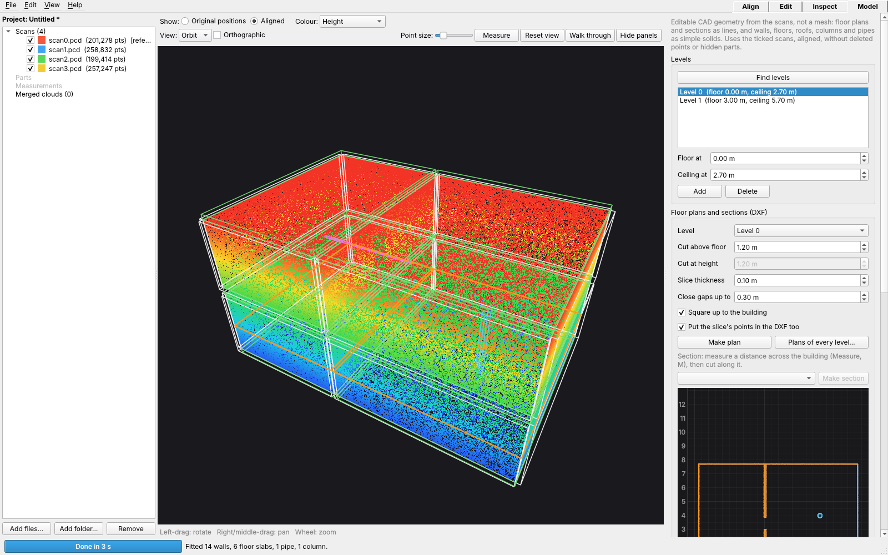

# Model mode: CAD geometry from the scans

Model mode turns the scans into **editable CAD geometry, not a mesh**:

* **Floor plans and sections** as 2D lines (DXF), for any CAD program.
* **Walls, floor slabs, roofs, columns and pipes** as simple solids with real
  dimensions: IFC for BIM programs, STEP for mechanical CAD, or 3D DXF.
* **Levels** (storeys) found automatically, so each floor gets its own plan
  and the IFC file is organised by storey.
* **Snapping**: measurements snap to the fitted corners, edges and faces.

It is the fourth tab, **Model**, next to Align, Edit and Inspect (F5). It
always works on the ticked scans in their aligned positions (and ticked merged
clouds), with deleted points and hidden parts left out, so Edit mode is the
place to clear out furniture or split off one floor first.

## Using it

1. **Find levels.** Looks for large level surfaces. A surface the scanners
   stood above is a floor, one they stood below is a ceiling. Each level gets a
   floor height and, if found, a ceiling height. Rename a level by
   double-clicking it; change its heights in the boxes below the list; **Add**
   a level by hand if one was missed (for example a mezzanine).
2. **Make plan.** Cuts the chosen level at *Cut above floor* (1.2 m, through
   walls, doors and windows) and traces the walls into lines. The lines show in
   orange in the 3D view and in the small 2D view in the panel. **Save DXF…**
   writes them out. **Plans of every level…** makes and saves one DXF per
   level in one go.
3. **Make section.** Measure a distance across the building (Measure, M), pick
   it in the list, and **Make section**: a vertical slice along that line, with
   floors, ceilings and walls traced. In the DXF, X is the distance along the
   line and Y the height.
4. **Fit shapes.** Fits the 3D model. Each shape is listed with its size and
   how closely it fits the scan (RMS, in mm); select one to see it in yellow,
   untick it to leave it out of the files, or **Delete** a wrong one. **Save
   IFC…**, **Save STEP…** or **Save 3D DXF…** write the ticked shapes.
   **Leave out shelves and furniture** (on by default) keeps only the
   building itself; untick it to fit everything flat or round in the scan.
   The bar shows how far reading and fitting have got, and **Cancel** stops
   it at any point.

The levels, the fitted shapes and the settings are kept in the project folder
(`model/model.json`) and come back when the project is opened.

### What the files contain

| File | Opens in | Contents |
| --- | --- | --- |
| Plan / section `.dxf` | AutoCAD, BricsCAD, DraftSight, LibreCAD, QCAD, FreeCAD, SketchUp, Rhino, Revit | Layer `WALLS`: the traced lines. `ROUND`: circles (columns, posts, pipes cut across). `SCAN`: the slice's points, to trace by hand what was missed (turn the layer off to hide it). `TEXT`: the drawing's name. DXF R12, metres. |
| `.ifc` | Revit, ArchiCAD, FreeCAD (BIM), BlenderBIM / Bonsai, SketchUp Pro, Solibri, any IFC viewer | IFC4. `IfcWall`, `IfcSlab` (floors and roofs), `IfcColumn`, `IfcPipeSegment`, each a rectangle or circle extruded to a depth, so length, thickness and height can be edited. Grouped into `IfcBuildingStorey`s from the levels. Property set `PCD_Merge_Fit` on every element: `FitRMS`, `ScanPoints`. |
| `.step` | Fusion, SolidWorks, Inventor, Onshape, FreeCAD, Rhino, Creo | AP214 exact solids (boxes and cylinders), one part. FreeCAD: *Part > Compound > Explode compound* to get the separate bodies. Metres. |
| 3D `.dxf` | Anything that reads DXF | The solids as 3D faces, one layer per kind. |

## How it works

**Levels.** A thin horizontal slice of the site covers a lot of ground at a
floor or ceiling and little elsewhere (just the walls). The covered area is
measured every 2 cm up the building and the peaks are the floors and ceilings.

**Plans and sections.** The slice (10 cm thick by default) is flattened and
thinned to one point per centimetre. Each point gets the direction of the line
its neighbours make; points in clutter are dropped. Neighbouring points on the
same line are joined into runs and each run becomes a straight line (a curved
wall becomes several). Then: lines within 3° of the building's main directions
are squared up to them; pieces of one wall less than *Close gaps up to* apart
are joined (doors, which are wider, stay open); ends near a corner are
extended or trimmed to meet exactly; and the two faces of a wall that stop at
the same place (a door, the end of a wall) are closed with a short line.
Leftover points that sit on a circle become circles.

**3D shapes.** The site is thinned to one point per cube of the chosen
*Detail* (5 cm by default) while it is read, a few million points at a time,
so even a very large scan is read in seconds to a minute, and each point gets the direction of its surface,
turned to face the scanner that saw it (from the scan's `VIEWPOINT`).
Neighbouring points on the same flat surface are grown into patches and each
large one (0.4 m² or more) becomes a face with a rectangular outline. Level
faces are made exactly level, upright ones exactly upright and square to the
building, and outlines are stretched to meet the neighbouring faces. Then:

* Two faces of a wall seen from the rooms on either side give a wall of the
  real thickness. A wall seen from one side only (an outside wall scanned from
  inside) gets the *One-sided walls* thickness, behind the face.
* A ceiling with a floor just above it gives a slab of the real thickness;
  otherwise the *One-sided slabs* thickness.
* Sloping faces become roof slabs.
* With *Leave out shelves and furniture*, the levels (from **Find levels**, or
  looked for afresh if there are none) tell the building from what stands in
  it. Level faces away from every floor and ceiling height are dropped
  (shelves, tables, worktops). An upright face is a wall only if it reaches
  the ceiling (within 35 cm) or stands at least 85% of the storey high; the
  ends and backs of shelving and cupboards don't. A wall that reaches the
  ceiling but whose lower part was hidden by something in front of it is
  carried down to the floor (not where the scan sees through, as in a
  doorway). A floor partly hidden under shelving is stretched to the ceiling
  above it. Pipes shorter than 1 m are dropped (the edges of shelf boards look
  like thin pipes).
* The leftover points are searched for cylinders: normals all square to one
  direction, points on a circle around it. Upright ones of 8 cm radius or more
  are columns, the rest pipes. An inside corner looks like a quarter of a pipe
  from the room, so a cylinder must bulge towards the scanner that saw it.

## Limits

* Shapes are boxes and cylinders. Walls are not cut for doors and windows (a
  door shows as a gap in the plan, but the IFC wall runs through it), L-shaped
  floors are one rectangle each piece, and curved walls are not fitted in 3D.
* Thin walls need to be seen from both sides by different scans to get their
  real thickness: one scan that sees both faces (through a door) can't tell them
  apart at coarse detail.
* Pipes much thinner than twice the *Detail* are missed; choose *Fine* for small
  pipes.
* The 3D fitting holds the thinned site in memory: at 5 cm detail up to about 6
  million points (a large building). Reading stops as soon as there are more,
  with a message. For a bigger site, choose *Coarse*, or
  split it into parts in Edit mode and fit one part at a time (only ticked parts
  are used).
* Merged clouds have no scanner position, so their normals can't be turned
  towards a scanner: walls are still found but their two faces are not paired,
  and levels fall back to "lowest is a floor".
* A wall that is hidden by shelving all the way up to the ceiling has nothing
  to fit to; scan from another spot, or draw it from the plan.
* ASCII and compressed PCD files are unpacked whole before the first points
  are thinned, so the bar waits at the start of such a file; binary PCD, PLY,
  LAS/LAZ and E57 are read a piece at a time.

## Removing Model mode

Model mode is an add-on kept apart from the rest of the app, so it can be taken
out cleanly if it is not wanted:

1. Delete the folder `pcd_merge/cad/` and the file `tests/test_cad.py`.
2. Delete `docs/model-mode.md` and `docs/model-mode.png`, and the *Model mode*
   paragraph in `README.md`.
3. In `pcd_merge/gui/main_window.py`, delete the function
   `install_model_mode` and the line `install_model_mode(self)` at the end of
   `MainWindow.__init__`. (If they are left in, the app still runs: without the
   folder the tab is simply not added.)
4. In `pyproject.toml`, remove `"pcd_merge.cad"` from `packages`.

Nothing else refers to it. It added no dependencies. Projects that used it keep
a `model` folder, which the app then ignores and which can be deleted.
